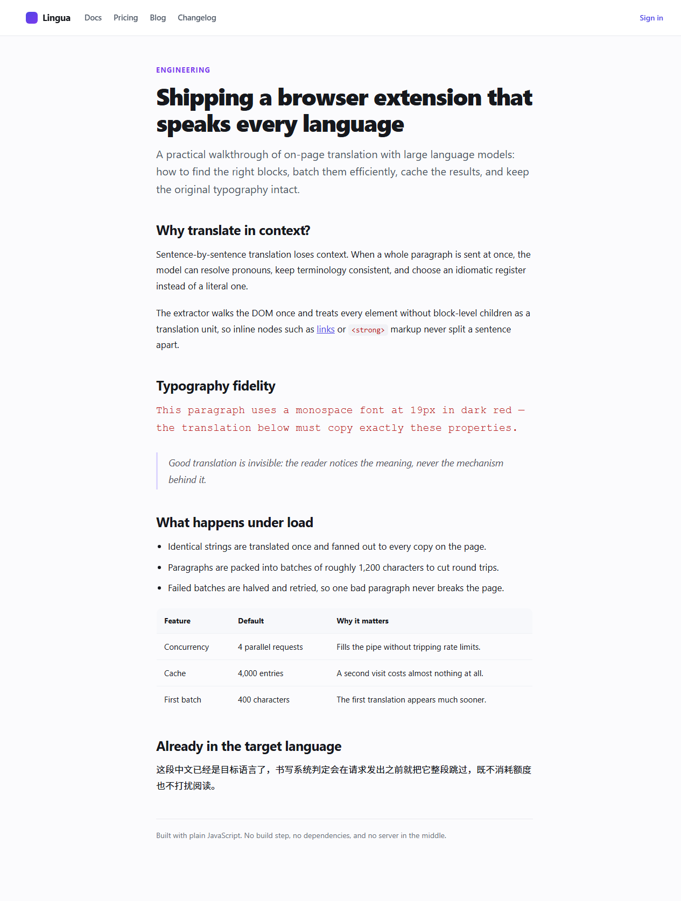
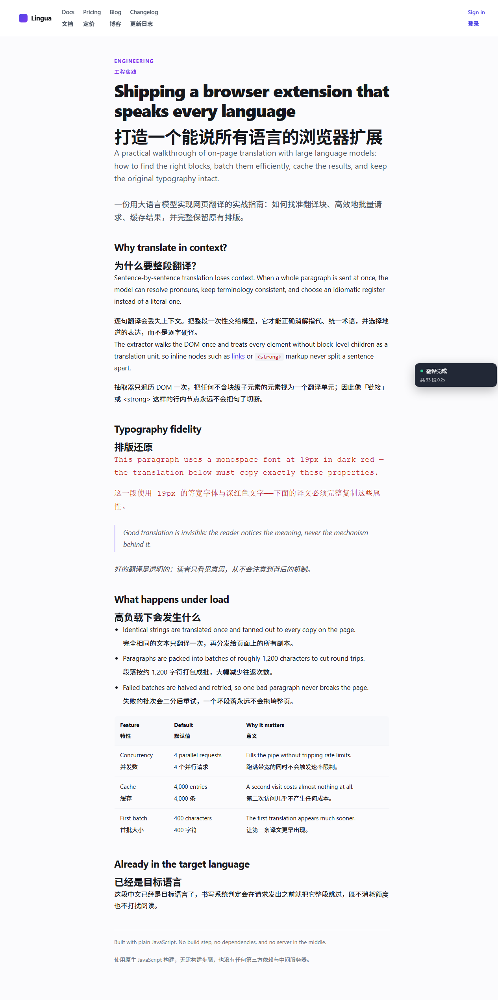
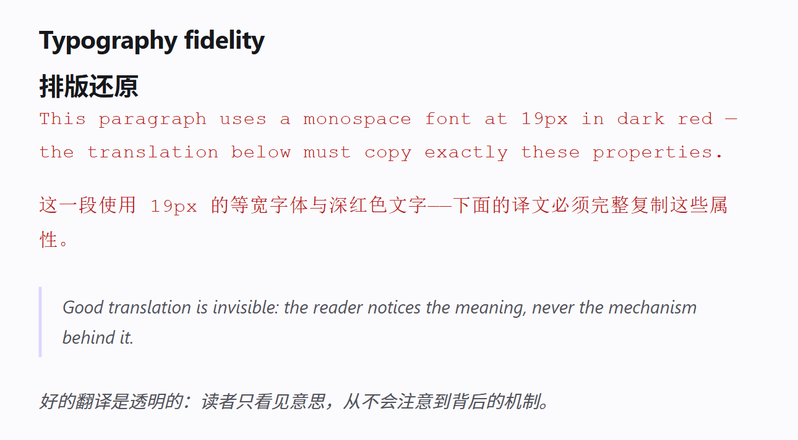

# AI 网页翻译 (AI Page Translator)

> 一个用**你自己的 AI API 密钥**翻译网页的 Edge / Chrome 扩展。
> 译文显示在原文段落**正下方**，字体、字号、行高、颜色**与原文完全一致**，并发数可调。

<p align="center">
  
</p>

---

## 🖼 效果预览

以下截图取自**真实运行**：无头 Edge 加载本扩展，翻译 `demo/showcase.html`。
共 32 个段落，**3 个 API 请求**（7 + 9 + 16 段分批），排版一致性校验 12/12 通过。

| 翻译前 | 翻译后 |
| --- | --- |
|  |  |

**排版一致性特写**——等宽 19px 深红段落、斜体引用块，译文的字体族 / 字号 / 字重 / 行高 / 颜色逐项与原文一致：



---

## ⚡ 无需 API 密钥的离线体验

仓库自带一个零依赖的本地模拟服务，用来验证完整链路（分批、并发、缓存、渲染）：

```bash
node tools/mock-ai-server.mjs --dict demo/showcase-dict.json
```

然后在扩展设置里填 **Base URL** `http://127.0.0.1:8931/v1`、**API 密钥留空**，
打开 <http://127.0.0.1:8931/demo/showcase.html> 就能得到与上面截图完全一致的效果。
（该服务只是本地回声服务，真实翻译仍然由你配置的模型完成。）

---

## ✨ 功能特性

| 能力 | 说明 |
| --- | --- |
| 🔑 自带密钥 | 支持 OpenAI / DeepSeek / 通义千问 / Kimi / 智谱 GLM / 硅基流动 / OpenRouter / Groq / Ollama / LM Studio / Anthropic Claude，也可填任意 OpenAI 兼容地址 |
| 📐 排版一致 | 译文放进原文所在元素内部，直接继承网页自己的字体、字号、颜色、对齐与间距；引用块竖线、卡片、提示框都能包住译文；网站切换深色模式译文同步变化 |
| ⬇️ 段落下译文 | 译文紧跟所属段落，段落间距保持原样；导航 / 按钮等短标签行内追加，不撑破固定高度的导航栏 |
| ✨ 动效 | 待翻译段落末尾显示跟随文字颜色的加载指示；译文按阅读顺序错峰浮现；跟随系统「减少动态效果」 |
| ⚡ 并发可调 | 1–32 路并发，同一密钥**跨标签页共享**上限；429 时自适应减半 + 全局冷却（尊重 `Retry-After`），之后逐步恢复 |
| 🌍 目标语言 | 70+ 种语言，随时切换，切换后自动重译 |
| 🧠 智能批处理 | 多个段落打包进一次请求，显著减少往返次数与 token 开销 |
| ♻️ 缓存与去重 | 页面内相同文本只翻一次；结果按 `hash(提示词+原文)` 缓存，跨标签页、跨会话复用 |
| 🛡️ 失败自愈 | 返回格式异常 / 上下文超限时自动二分拆分，最终退化到逐条翻译，绝不整页失败 |
| 🚨 快速失败 | 401/403/404 判定为致命错误，立即停止全部请求，不浪费 token |
| 🔄 动态页面 | SPA / 无限滚动新内容增量追加到运行中的任务（不中止在途请求）；原文被页面改写时自动重译；译文被框架重渲染抹掉时自动补回 |
| 🙈 不乱翻 | 人名、@用户名、#话题、$代码、计数、比分、时间不翻；元素自带 `lang` 或浏览器内置语言识别判定已是目标语言的段落不发送；模型原样返回的内容不重复显示；短按钮不翻；虚拟列表的隐藏占位不翻 |
| 🔕 不打扰 | 只有你主动发起的翻译才显示进度与「翻译完成」；滚动加载、实时刷新的内容静默增量翻译；同一内容被重新挂载时直接复用译文，不再请求 |
| 🎯 视口优先 | 先翻译用户正在看的内容（首批请求更小），首屏译文出现更快 |
| 🔒 隐私安全 | 密钥只存在本机 `chrome.storage.local`，不经过任何中转服务器 |

---

## 🚀 安装（Edge / Chrome 解压加载）

1. 下载或克隆本仓库到本地：
   ```bash
   git clone https://github.com/suyzhi/webpage-ai-translator.git
   ```
2. 打开浏览器扩展页：
   - Edge：地址栏输入 `edge://extensions/`
   - Chrome：地址栏输入 `chrome://extensions/`
3. 打开右下角 / 右上角的 **开发者模式**。
4. 点击 **加载解压缩的扩展**，选择本仓库根目录（含 `manifest.json` 的那一层）。
5. 扩展安装后会自动打开设置页；也可以点击工具栏里的扩展图标 → ⚙。

> 安装后请到 **设置 → AI 服务** 填入 Base URL、API 密钥与模型名，点 **测试连接** 确认可用。

---

## 📖 使用

1. 打开任意网页。
2. 点击工具栏中的扩展图标 → **翻译此页面**（或按 `Option + A`（Windows / Linux 为 `Alt + A`），或右键页面 → *AI 翻译此页面*）。
3. 页面右下角会显示进度浮层与完成提示；工具栏图标上的角标显示百分比。
4. 再次点击按钮 / 快捷键即可 **还原原文**（翻译进行中按快捷键会立即停止并还原）。

> 快捷键没反应？可能被其他扩展占用，或从旧版本升级后浏览器保留了旧绑定：打开 `chrome://extensions/shortcuts`（Edge 为 `edge://extensions/shortcuts`）手动设置为 `Option + A`。弹出面板底部也会显示当前生效的快捷键，点击即可跳转设置。

默认只翻译**当前屏幕附近**的内容，向下滚动时再按需翻译后续段落，长页面不会一次性把整页送去翻译，显著节省 token。如需一次翻完整页，可在设置中关闭「按需翻译」。

弹出面板里可以快速调整 **目标语言**、**并发数量**、**显示方式（双语对照 / 仅译文）**，修改立即保存并对当前页面生效。

---

## ⚙️ 设置项

### AI 服务
| 项 | 说明 |
| --- | --- |
| 接口协议 | `OpenAI 兼容`（`/chat/completions`）或 `Anthropic`（`/messages`） |
| Base URL | 填到 `/v1` 即可，程序自动补全；也可直接填完整 URL |
| API 密钥 | 仅保存在本机；勾选"显示"可查看 |
| 模型 | 新装默认 DeepSeek `deepseek-flash`，填入密钥即可使用；任意对话模型均可，带 datalist 常见模型建议。DeepSeek V4 系列默认开启思考，扩展会自动关闭（实测输出 token −64%、耗时 −63%）。填入推理模型（如 `deepseek-reasoner`、o 系列）时会提示改用非推理模型；模型只返回思考过程时立即停止并报错，不会反复重试 |

设置页默认只显示常用项（服务商、密钥、模型、目标语言、显示方式、标记样式、自动翻译）；接口协议 / Base URL 收在「自定义接口」里（使用非预设地址时自动展开），其余选项收在各分区的「更多选项」「高级参数」里。

### 翻译设置
| 项 | 默认 | 说明 |
| --- | --- | --- |
| 目标语言 | 简体中文 | 70+ 种语言 |
| 原文语言 | 自动识别 | 一般无需设置 |
| 显示方式 | 双语对照 | 或"仅显示译文"（自动隐藏原文段落） |
| 译文标记样式 | 无 | 可选下划线 / 左侧竖线 / 浅色底纹 / 弱化；颜色取自文字颜色，**不影响字体字号** |
| 跳过已是目标语言的文本 | 开 | 按书写系统判定，减少无效请求 |
| 翻译网页标题 | 开 | 同步翻译标签页标题 |
| 按需翻译 | 开 | 只翻译视口附近的内容，滚动到再翻；关闭则一次翻完整页 |
| 自动翻译 | 关 | 开启后进入网页自动翻译（通过动态注册内容脚本实现，关闭时零开销） |
| 仅对这些网站自动翻译 | 空 | 每行一个域名（含子域名）；留空 = 所有网站。名单外的网站连脚本都不注入。弹出面板可对当前网站一键开关 |
| 从不自动翻译这些网站 | 空 | 优先级最高；手动翻译不受影响 |
| 最短翻译长度 | 2 | 过滤导航碎词、数字、符号 |
| 自定义提示词 | 空 | 追加到系统提示词，如"专业术语保留英文" |

### 性能与可靠性
| 项 | 默认 | 说明 |
| --- | --- | --- |
| 并发数量 | 4 | 同时进行的 API 请求数，推荐 3–8；付费高配额可试 16–32 |
| 每批字符数 | 5000 | 单次请求打包的原文上限；越大系统提示词的固定开销摊得越薄（DeepSeek 不缓存这么短的前缀，每次请求都全额计费） |
| 每批段数 | 64 | 单次请求打包的段落数上限 |
| 首批字符数 | 400 | 首批更小 → 首屏译文更快出现 |
| 失败重试次数 | 2 | 每个批次的重试上限 |
| 单次超时 | 60000 ms | 超时后把批次拆半重试（不原样重发整批） |
| 缓存上限 | 4000 条 | 超出按 LRU 淘汰 |
| 启用翻译缓存 | 开 | 关闭则每次重新翻译 |
| token 用量 | — | 弹出面板显示本页 / 累计用量与提示词缓存命中率；设置页可查看明细与清零 |

> 从旧版本升级时会做一次性迁移：仍是旧默认值（1200 / 16、2000 / 24）的批次设置升级为 5000 / 64（自己改过的值不动）；DeepSeek 官方地址上的 `deepseek-chat`（现为 `deepseek-flash` 的别名）改为 `deepseek-flash`；并清空旧翻译缓存（系统提示词已更新，旧缓存不会再命中）。

---

## 🧠 算法与架构

```
┌─────────────────── 内容脚本（页面内） ───────────────────┐
│ extract.js   段落切分：块级/行内判定 → 叶子块即翻译单元      │
│              混合元素：行内部分单独成单元 + 精确插入锚点     │
│ render.js    排版复制 + 自适应插入（flex/grid/列表/表格）   │
│ content.js   视口优先排序 → 端口流式请求 → rAF 逐帧渲染     │
│              MutationObserver 增量翻译 / 断线重连 / 心跳    │
└──────────────────────────┬───────────────────────────────┘
                           │ chrome.runtime.connect (流式)
┌──────────────────────────▼───────────────────────────────┐
│ engine.js    去重 → 缓存 → 占位符保护 → 打包 → 并发池        │
│              重试退避 → 二分拆分自愈 → 致命错误快停           │
│ providers.js OpenAI 兼容 / Anthropic 适配 + HTTP 错误分类   │
│ cache.js     内存 LRU + chrome.storage.local 持久化         │
│ service-worker.js  端口/消息路由、注入控制、角标、注册       │
└──────────────────────────────────────────────────────────┘
```

### 1. 段落切分（`extract.js`）
单次 O(n) 自顶向下遍历，读写分离避免布局抖动：

- 只有**不含块级子元素**的元素才作为"叶子块"，其全部行内文本构成一个翻译单元 —— 保证句子语义不被切碎；
- 同时含**块级子元素**与**行内文本**的混合元素，其行内部分单独成单元，插入锚点定位在最后一个行内节点之后，视觉上恰好落在该行文字下方；
- 纯行内元素（`<a>` `<strong>` …）不单独成单元，其文本并入所属块；
- 过滤规则：`display:none`/`visibility:hidden`、`<pre>`/`<code>` 代码块、输入控件、`translate="no"`、`.notranslate`、`contenteditable`、已是目标语言、纯数字/符号/短词。
- `display:contents` 的包装层（MDN、Next.js、Reddit、BBC 等把整个 `<main>` 包在里面）按容器向内遍历，不会被当成不可见；
- **Shadow DOM**：open 影子根直接遍历，closed 影子根经 `chrome.dom.openOrClosedShadowRoot` 读取；影子树第一层有块级内容的宿主按容器处理，句中的行内组件（如 `<relative-time>`）连同 slot 投影的文字并入整句；途经的影子根逐个加入变化观察，组件内的动态内容同样增量翻译。

### 2. 批量协议（`prompt.js`）
每段一行 `N|文本`，段内换行写作 `<br>`，原文不做 XML 转义。比旧的 `<t id="n">…</t>` 标签省 token：真实 DeepSeek 整页实测输入 −12%、输出 −20%，格式遵循率不变。
解析容错：以 `N|` 开头的行开始一段、其余非空行并入上一段 → 兼容旧标签格式 → 仍缺片段则二分拆分为逐条重译。

### 3. 性能优化
| 手段 | 收益 |
| --- | --- |
| 文本去重 | 导航/页脚等重复文案只翻一次 |
| 持久化缓存 | 二次访问同一页面几乎零请求 |
| O(1) LRU 缓存索引 | 命中/写入不再随缓存条目数线性变慢（`tools/bench.mjs` 可复现） |
| 目标脚本快速判定 | 源语言页面跳过 20+ 次全量正则扫描 |
| 批量打包 | 请求数从 N 降到 N/16 量级 |
| 视口优先 + 更小的首批 | 首屏译文最快出现 |
| 并发池 | 按设置的并发数打满带宽 |
| 读写分离 + 分帧渲染 | 每帧先批量读样式再批量写 DOM，单帧预算约 10ms，大量缓存命中时也不卡顿 |
| 按需注入 | 不翻译时页面上不存在任何内容脚本 |

### 4. 可靠性
| 场景 | 处理 |
| --- | --- |
| 429 | 共享限流器并发减半 + 全局冷却，额外重试不消耗普通重试次数；**不拆分批次**（拆分只会放大请求量） |
| 5xx / 网络抖动 | 指数退避 + 抖动重试；同样不拆分，避免对过载服务成倍加压 |
| 响应头已到、响应体卡住 | 超时覆盖整个响应体读取，不会永久占用并发名额 |
| 400 / 413（上下文超限） | 批次二分拆分后重试 |
| 模型返回格式异常 / 少片段 | 仅对缺失片段重发；仍失败则拆分为单条 |
| 401 / 403 / 404 | 判定致命，立即停止全部请求并在页面提示 |
| Service Worker 被回收 | 内容脚本检测端口断开 → 自动重连 → 补发未完成片段 |
| 长任务后台休眠 | 20s 心跳 + 每批结果消息持续重置空闲计时器 |
| 单条最终失败 | 只丢这一条，其余照常渲染；页面提示与弹出面板均可「重试失败段落」，无需整页重翻 |

---

## 🧪 开发与测试

零构建、零依赖：所有源码为可直接加载的普通脚本（content script 为经典脚本，后台用 `importScripts`）。

```bash
# 运行 80 项单元 / 集成测试（Node 18+，无需安装任何依赖）
npm test

# 无头浏览器端到端测试：真实加载扩展 + 本地 mock 服务，跑通 抽取→打包→请求→渲染→还原
# （需要支持扩展调试的较新 Chrome/Edge；可用 CHROME_PATH 指定浏览器）
npm run test:e2e

# 抽取阶段压力测试：真实压力页 + 合成 500/2000/5000 段落 + 边界用例（含 display:contents、Shadow DOM、slot）
npm run test:extract

# 真实网站评测（指标定义与历次结果见 docs/metrics.md）：
npm run eval:coverage                     # 42 个真实网站的抽取召回率与漏抽原因
npm run eval:cost                         # 用上一步抓到的真实段落离线重放，统计 token 放大系数
DEEPSEEK_API_KEY=sk-… npm run eval:cost -- --real --only wikipedia,mdn   # 真实 API：token、耗时、失败数

# 插件 UI 回归：断言 popup/options 布局与保存链路，并输出浅色/深色截图
npm run test:ui

# 动态内容 + 高并发：翻译中追加段落、多标签页共享并发上限、原文改写重译、译文补回、仅译文隐藏/还原
npm run test:dynamic

# 社交媒体场景（demo/social.html，仿 X 时间线）：不该翻的不翻、完成提示只出现一次、页面持续跳动时不弹窗不请求、
# 无限滚动静默增量、虚拟列表回收复用译文、推文编辑后重译
npm run test:social
# 也可对真实公开页面做冒烟（边滚动边观察）：
node tools/e2e-social.mjs --url https://mastodon.social/explore --lang en-US

# 微基准：缓存读写与文本扫描热点
npm run bench

# 重新生成图标（纯 Node 手写光栅化 + PNG 编码，无第三方库）
npm run icons
```

测试覆盖：文本规范化、缓存键、占位符保护与还原、语言判定、批量打包、并发池、
LRU 淘汰、提示词构造与三级解析、HTTP 错误分类、**渲染与插入位置决策**
（内部放置 / 横排容器主体子元素 / 短标签行内 / 截断元素外置 / 仅译文隐藏与还原），以及**完整引擎链路**
（去重 / 缓存命中 / 批量 / 429 重试与不拆分 / 400 拆分 / 401 快停 / 网络失败降级 / 缓存跨实例持久化 /
共享限流 / 增量追加 / 响应体卡住超时）。
此外六个真实浏览器回归脚本：`npm run test:lazy`（按需翻译、流式改写、用量统计、按网站自动翻译）、`npm run test:social`（社交媒体场景）、`npm run test:dynamic`（动态内容与高并发）、`npm run test:e2e`（加载扩展跑通翻译全链路）、
`npm run test:extract`（抽取阶段压力与边界）、`npm run test:ui`（popup/options 布局与保存链路）。

手工验证页面：
- `demo/test-page.html` —— 压力用例（标题、链接、列表、表格、代码块、flex 导航、嵌套卡片、`translate="no"`、中英混排、特殊字体段落）；
- `demo/showcase.html` + `tools/mock-ai-server.mjs` —— 可复现的离线效果演示（见上文截图）。

### 目录结构
```
manifest.json                 MV3 清单（按需注入，无 content_scripts 常驻）
src/
  shared/   constants.js util.js settings.js prompt.js theme.css
  background/  service-worker.js engine.js providers.js cache.js
  content/  extract.js render.js content.js
  popup/    popup.html popup.css popup.js
  options/  options.html options.css options.js
icons/      16/32/48/128 PNG（由 tools/make-icons.mjs 生成）
tests/      wpt.test.mjs engine.test.mjs render.test.mjs
demo/       test-page.html showcase.html showcase-dict.json social.html
docs/       screenshots/ 效果截图
tools/      make-icons.mjs mock-ai-server.mjs bench.mjs
            e2e-headless.mjs e2e-extract.mjs e2e-ui.mjs e2e-dynamic.mjs e2e-social.mjs lib/cdp.mjs
```

---

## ❓ FAQ

**Q：会不会把我的密钥上传到别的地方？**
不会。密钥只写入本机 `chrome.storage.local`，请求由扩展后台直接发往你填写的 API 地址，没有任何中转服务。

**Q：译文和原文的字体为什么能一致？**
译文节点的排版属性是从原文元素的 `getComputedStyle` 逐条复制的（字体族、字号、字重、行高、字距、颜色、对齐、缩进），而不是靠 CSS 继承碰运气。

**Q：为什么不翻译 `<code>`/`<pre>` 里的内容？**
代码块翻译后会失去可读性甚至被破坏。段落内的行内 `<code>` 文本会作为句子的一部分一起送去翻译，但不会单独成段。

**Q：页面很长会不会发很多请求？**
不会。默认只翻译视口附近的内容，段落按"每批 5000 字符 / 64 段"打包，一屏内容通常只需 1–2 个请求；加上去重与缓存，二次打开几乎零请求。实际消耗可在弹出面板的用量统计里看到。

**Q：并发开多少合适？**
默认 4，上限 32。免费额度或小模型建议 2–3；付费高配额可开到 8–16，极限可试 32。该上限对同一密钥的所有标签页合计生效；过高触发 429 时扩展会自动减半并冷却、再逐步恢复，不会形成请求风暴。

**Q：支持 iframe 吗？**
当前只处理顶层文档。跨域 iframe 需要额外权限与独立的翻译调度，暂未开启以保证性能与可靠性。

**Q：接口报 404 / 模型不存在？**
检查 Base URL 是否填到了 `/v1`（如 `https://api.deepseek.com/v1`），以及模型名是否与供应商文档一致；点设置页的 **测试连接** 可直接看到原始错误。

---

## 📄 许可

[MIT](LICENSE)
